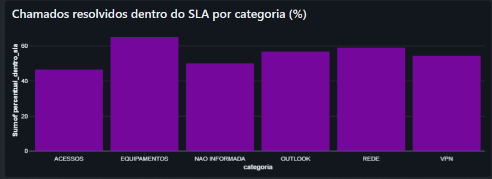
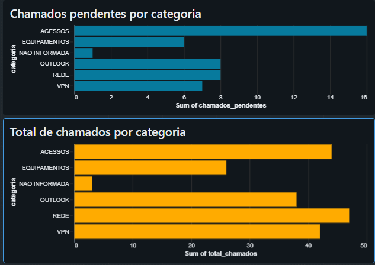

# Análise de Chamados de Suporte de TI

Projeto de portfólio desenvolvido com Databricks, PySpark, SQL e Delta Lake para analisar chamados de suporte técnico.

Utiliza dados fictícios e uma organização em camadas Bronze, Silver e Gold.

## Objetivo

Transformar registros de chamados em indicadores que ajudem a entender:

- Quais categorias concentram mais chamados.
- Quantos chamados estão resolvidos ou pendentes.
- Qual é o tempo médio de resolução por categoria.
- Qual percentual dos chamados resolvidos cumpriu o SLA.

SLA é o prazo definido para resolver um chamado.

## Tecnologias

- Databricks
- Python e PySpark
- SQL
- Delta Lake
- Dashboards do Databricks

## Organização dos dados

| Camada | Tabela | Finalidade |
|---|---|---|
| Bronze | chamados_suporte | Dados originais importados do CSV |
| Silver | silver_chamados | Dados tratados e enriquecidos |
| Gold | gold_chamados_categoria | Indicadores agrupados por categoria |

As tabelas são utilizadas no catálogo `workspace`, schema `default`.

## Tratamento e qualidade dos dados

- Remoção de registros totalmente duplicados.
- Remoção de espaços extras e padronização das categorias em maiúsculas.
- Preenchimento de categorias ausentes com `NAO INFORMADA`.
- Cálculo do tempo de resolução em horas.
- Comparação do tempo de resolução com o prazo de SLA.
- Validações de IDs, categorias e datas antes da criação da Gold.

Chamados sem fechamento mantêm o tempo de resolução e a avaliação de SLA nulos.

## Regras dos indicadores

- **Resolvidos:** chamados com status `Resolvido`.
- **Pendentes:** chamados com status `Aberto` ou `Em atendimento`.
- **Tempo médio:** média do tempo de resolução dos chamados resolvidos com duração disponível, em horas corridas.
- **Dentro do SLA:** tempo de resolução menor ou igual ao prazo definido.
- **Percentual dentro do SLA:** considera apenas chamados resolvidos com avaliação de SLA disponível.

## Resultados da base de exemplo

| Indicador | Quantidade |
|---|---:|
| Registros originais | 205 |
| Duplicatas removidas | 5 |
| Chamados após tratamento | 200 |
| Chamados resolvidos | 154 |
| Chamados pendentes | 46 |

Os resultados representam uma base fictícia criada para estudo.

## Dashboard

## Arquivos

- `01_tratamento_chamados.ipynb`: notebook de tratamento, validação e análise.
- `chamados_suporte.csv`: base original com dados fictícios.
- `Screenshot_1.png` e `Screenshot_2.png`: imagens do dashboard.

## Como reproduzir

1. Importe o CSV no Databricks como a tabela `workspace.default.chamados_suporte`.
2. Confira se `data_abertura` e `data_fechamento` estão como timestamp e `sla_horas` como número.
3. Importe o notebook `01_tratamento_chamados.ipynb`.
4. Caso utilize outro catálogo ou schema, ajuste os nomes das tabelas no notebook.
5. Execute as células em ordem para gerar a Silver, validar os dados e criar a Gold.
6. Crie um dashboard usando a tabela `workspace.default.gold_chamados_categoria`.

O notebook pressupõe que a tabela Bronze já foi importada. As tabelas Silver e Gold são sobrescritas durante o processamento.

As imagens documentam o dashboard; sua configuração precisa ser recriada no Databricks.

## Aprendizados

- Transformação de dados com PySpark.
- Consultas e agregações com SQL.
- Persistência de tabelas em Delta Lake.
- Organização em camadas Bronze, Silver e Gold.
- Validações de qualidade dos dados.
- Construção de indicadores de suporte de TI.
